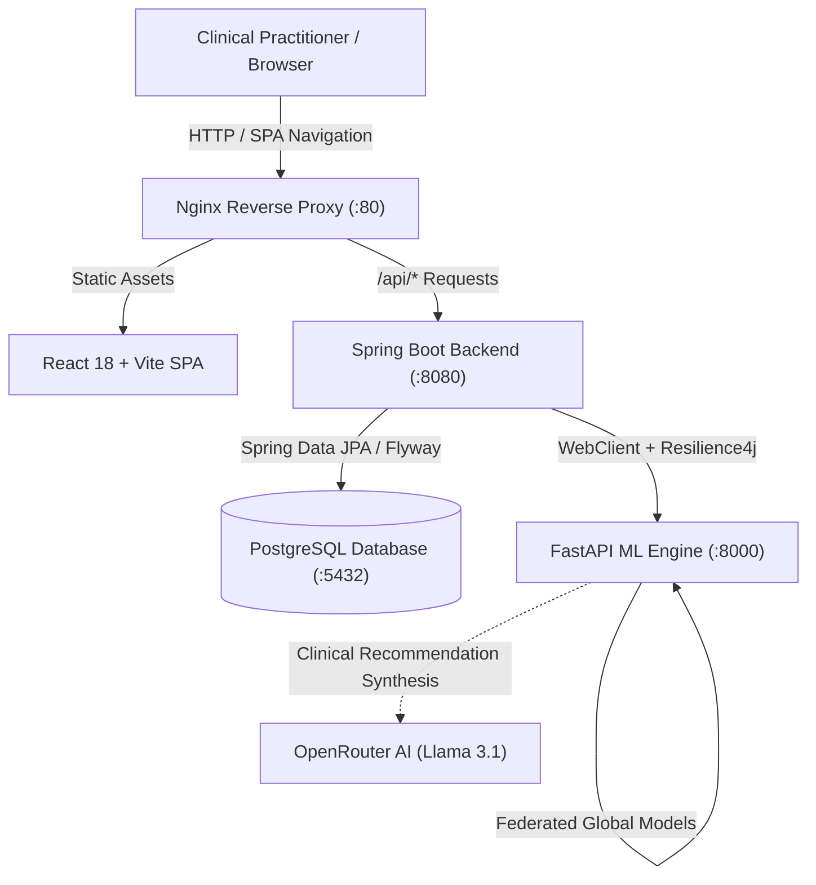

# FedMed AI — Backend Microservice & Platform Orchestrator

> Decentralized, Privacy-Preserving Healthcare Intelligence & Multi-Disease Diagnostic Platform

[](https://www.oracle.com/java/)
[](https://spring.io/projects/spring-boot)
[](https://www.postgresql.org/)
[](https://flywaydb.org/)
[](https://resilience4j.readme.io/)
[](https://spring.io/projects/spring-security)

FedMed AI is a distributed medical analytics and clinical decision-support platform designed to address a critical healthcare challenge: **enabling healthcare institutions to collaborate on predictive AI model development without moving sensitive patient health records out of local hospital infrastructure.**

This repository houses the **Spring Boot Core Backend Service**—the central operational orchestrator responsible for tenant security, multi-hospital patient registries, HIPAA audit event logging, automated federated training scheduling, and resilient diagnostic dispatch to external machine learning engines.

---

## Architecture Overview

FedMed AI operates as a coordinated 3-tier microservice architecture. The Spring Boot backend functions as the secure gateway and administrative hub, interfacing with PostgreSQL for relational storage and a specialized Python service for federated machine learning:



### Component Communication Boundaries

| Source | Destination | Protocol / Mechanism | Purpose |
| :--- | :--- | :--- | :--- |
| **Frontend** | **Backend** | HTTP / JSON REST (`/api/*`) | User authentication, patient management, analytics queries |
| **Backend** | **PostgreSQL** | JDBC (HikariCP Pool, Port 5432) | Relational persistence, Flyway migrations, audit trails |
| **Backend** | **ML Service** | HTTP / JSON (`WebClient`, Port 8000) | Multi-disease prediction dispatch, federated training triggers |
| **ML Service** | **OpenRouter** | HTTPS REST (External API) | Optional LLM-assisted clinical lifestyle synthesis |

---

## Project Highlights

### Backend-Owned Responsibilities
- **Multi-Tenant Hospital Isolation:** Hospital-level data partitioning enforced in the data access layer and via Spring Security expressions (`@tenantSecurity.hasHospitalAccess`).
- **Stateless JWT Security & Rate Limiting:** 15-minute access token lifespan, 7-day refresh tokens, BCrypt password hashing, and in-memory sliding-window IP rate limiting (`RateLimitingFilter`).
- **Resilient ML Client Integration:** Downstream prediction calls protected by Resilience4j Circuit Breakers, connection pooling (`WebClientConfig`), and a local heuristic fallback engine (`FallbackPredictionEngine`).
- **HIPAA-Aware Audit Interceptor:** Custom AOP aspect (`@Audited`) that automatically sanitizes and masks Personally Identifiable Information (PII/PHI) before persisting audit events to the database.
- **Automated Training Scheduler:** Persistent cron-based scheduler triggering decentralized model aggregation rounds across participating hospital nodes.
- **Versioned Schema Migrations:** Flyway-managed schema evolutions (`V1` to `V5`) guaranteeing repeatable deployments without manual database modification.

### Platform-Wide Collaborating Services
- **Federated Machine Learning (`ml-service`):** Scikit-learn model training across 5 disease domains (Heart, Diabetes, Kidney, Liver, Stroke) coordinated via sample-weighted Federated Averaging (`FedAvg`) and Flower (`flwr`).
- **Clinical Web Application (`fl-medical-frontend`):** Responsive React 18 interface with dark/light design tokens, interactive Recharts visualizations, and 18-parameter diagnostic calculators.

---

## Engineering Highlights

| Capability | Implementation Mechanism | Engineering Value |
| :--- | :--- | :--- |
| **REST Architecture** | 10 Spring `@RestController` classes, uniform `ApiResponse<T>` envelope | Predictable, standardized API contract for client consumers |
| **Multi-Tenancy** | `TenantSecurity.java` evaluated via SpEL `@PreAuthorize` | Prevents cross-tenant data access between competing hospital facilities |
| **Data Masking** | `PatientDataMasker.java` invoked via `AuditAspect.java` | Protects patient privacy by masking names and identifiers in audit records |
| **Fault Tolerance** | Resilience4j `mlServiceCircuitBreaker` & `FallbackPredictionEngine` | Prevents cascading service failures when the external ML container is unavailable |
| **Connection Pooling** | HikariCP (`max-pool-size: 20`, leak detection threshold: 2000ms) | Prevents database connection exhaustion during concurrent clinical traffic |
| **Database Migrations** | Flyway versioned scripts (`V1__init` through `V5__add_weights_path`) | Deterministic, version-controlled schema evolution across environments |
| **Validation & Errors** | Jakarta `@Valid` on DTOs, `@RestControllerAdvice` in `GlobalExceptionHandler` | Centralized exception-to-HTTP mapping with field-level validation errors |
| **Automated Testing** | JUnit 5, Mockito, Spring Boot Test | Regression verification for masking rules, fallback logic, and service layers |

---

## API Documentation

The backend exposes authenticated REST endpoints under the `/api` prefix. Interactive OpenAPI documentation is accessible locally via **Swagger UI** at `http://localhost:8080/swagger-ui.html`.

### Main Endpoint Groups

| Group | Base Route | Controller | Auth Required | Purpose |
| :--- | :--- | :--- | :--- | :--- |
| **Auth** | `/api/auth` | `AuthController` | None | User authentication, node registration, token refresh |
| **Patients** | `/api/patients` | `PatientController` | Bearer JWT | Hospital-scoped patient registration, updating, and search |
| **Predictions** | `/api/predictions` | `PredictionController` | Bearer JWT | Multi-disease prediction dispatch, risk history, patient timeline |
| **Hospitals** | `/api/hospitals` | `HospitalController` | `ROLE_ADMIN` | Participating hospital node configuration and telemetry status |
| **Models** | `/api/models` | `ModelController` | `ROLE_ADMIN` | Global model versions, manual FedAvg execution, weights inspection |
| **Analytics** | `/api/analytics` | `AnalyticsController` | Bearer JWT | Dashboard metrics, hospital node telemetry, disease distributions |
| **Scheduler** | `/api/scheduler` | `SchedulerController` | `ROLE_ADMIN` | Cron-based automated training schedule management |
| **Export** | `/api/export` | `ExportController` | Bearer JWT | Masked patient cohort and diagnostic risk CSV data exports |
| **Jobs** | `/api/jobs` | `JobController` | `ROLE_ADMIN` | Background asynchronous task execution tracking |
| **Training Logs** | `/api/training-logs` | `TrainingLogController` | `ROLE_ADMIN` | Historical federated training round metrics and telemetry |

### Example Workflows

#### 1. Practitioner Authentication
```http
POST /api/auth/login
Content-Type: application/json

{
  "username": "hospital1_admin",
  "password": "your-password"
}
```
**Response (HTTP 200 OK):**
```json
{
  "success": true,
  "message": "Login successful",
  "data": {
    "accessToken": "eyJhbGciOiJIUzUxMiJ9...",
    "refreshToken": "4d8c1a0d-e965-47a0...",
    "tokenType": "Bearer",
    "expiresIn": 900,
    "user": {
      "id": 2,
      "username": "hospital1_admin",
      "fullName": "General Hospital Lead",
      "role": "HOSPITAL_ADMIN"
    }
  }
}
```

#### 2. Multi-Disease Risk Prediction
```http
POST /api/predictions
Authorization: Bearer <accessToken>
Content-Type: application/json

{
  "patientId": 1,
  "features": [55.0, 1.0, 145.0, 240.0, 78.0, 110.0, 27.5, 1.0, 1.0, 0.0, 1.1, 14.0, 0.8, 35.0, 4.2, 4.5, 140.0, 25.0]
}
```
**Response (HTTP 200 OK):**
```json
{
  "success": true,
  "message": "Multi-disease prediction completed successfully",
  "data": {
    "modelVersion": "v1.0",
    "totalDiseasesChecked": 5,
    "predictions": [
      {
        "disease_type": "heart_disease",
        "disease_name": "Heart Disease",
        "prediction": 1,
        "prediction_label": "Heart Disease Detected",
        "confidence": 0.842,
        "risk_level": "HIGH",
        "probabilities": [0.158, 0.842]
      }
    ],
    "recommendations": {
      "source": "OpenRouter AI",
      "overall_summary": "Patient demonstrates elevated cardiac risk factors requiring clinical attention.",
      "most_urgent": "Schedule cardiologist consultation within 48 hours"
    }
  }
}
```

---

## Reliability & Error Handling

All controller errors are intercepted by `GlobalExceptionHandler` and converted into standardized JSON envelopes:

```json
{
  "success": false,
  "message": "Detailed error description",
  "data": null,
  "timestamp": "2026-10-25T14:30:00.000"
}
```

- **Validation Errors (HTTP 400):** When request DTOs violate Jakarta Validation annotations (`@NotBlank`, `@Min`, `@NotNull`), the response includes a key-value mapping of invalid fields and error causes.
- **Access Denied (HTTP 403):** If a `HOSPITAL_ADMIN` attempts to view or modify patients belonging to a different `hospital_id`, `TenantSecurity` denies authorization.
- **ML Service Disconnection (Resilience4j):** If the Python ML container times out or is unreachable:
  - If `fallback.prediction.enabled` is active, the backend logs a warning and computes deterministic heuristic scores via `FallbackPredictionEngine` to prevent clinical workflow interruption.
  - If disabled, an `MLServiceException` is caught and returned as HTTP 503 Service Unavailable.
- **Rate Limit Exceeded (HTTP 429):** Excessive requests within a 60-second sliding window are throttled by `RateLimitingFilter`.

---

## Database Architecture & Migrations

The backend uses PostgreSQL 15 managed through Flyway. Database tables, foreign key constraints, indexes, and initial seeds are version-controlled:

```text
src/main/resources/db/migration/
├── V1__init_schema.sql                           # Core tables: users, hospitals, patients, predictions, models
├── V2__add_performance_indexes_and_soft_delete.sql # Composite indexes on hospital_id and deleted flags
├── V3__add_jobs_table.sql                       # Asynchronous background job executions
├── V4__add_audit_logs_table.sql                 # PHI access audit event tracking
└── V5__add_weights_path.sql                     # Model weights filesystem storage paths
```

---

## Getting Started

### Prerequisites
- **Java Development Kit (JDK):** Version 17
- **Database:** PostgreSQL 15 (running locally or in a container)
- **Build Tool:** Maven 3.9+ (or use the included `./mvnw` wrapper)
- **Optional ML Engine:** Python ML service running on port 8000 for live model predictions

### Environment Configuration

The application is configured through `application.yml` and accepts overrides via environment variables:

| Variable | Default Value | Description |
| :--- | :--- | :--- |
| `PORT` | `8080` | Spring Boot HTTP server port |
| `DB_URL` | `jdbc:postgresql://localhost:5432/fedlearn_medical` | PostgreSQL JDBC connection URL |
| `DB_USERNAME` | `postgres` | Database username |
| `DB_PASSWORD` | *(configured in environment)* | Database user password |
| `JWT_SECRET` | *(HMAC-SHA512 secret)* | Secret key used for signing JWT access tokens |
| `ML_SERVICE_URL` | `http://localhost:8000` | Base URL of the Python FastAPI ML microservice |
| `CORS_ALLOWED_ORIGINS`| `http://localhost:5173,http://localhost:3000` | Allowed CORS origins for frontend web clients |
| `FLYWAY_ENABLED` | `true` | Automatically run database migrations on startup |

### Build, Run & Test

```bash
# 1. Clone the repository and navigate to backend directory
cd "federated learning medical diagnosis/fl/fl-medical-backend"

# 2. Run unit and integration tests
./mvnw clean test

# 3. Package executable JAR (skipping tests if DB is offline)
./mvnw clean package -DskipTests

# 4. Start the application locally
./mvnw spring-boot:run
```

Once running, verify backend health:
```bash
curl -s http://localhost:8080/actuator/health
```

---

## Container Deployment

The backend contains a production-ready, multi-stage `Dockerfile`:
1. **Build Stage:** `eclipse-temurin:17-jdk-alpine` compiles the JAR via Maven.
2. **Runtime Stage:** `eclipse-temurin:17-jre-alpine` executes the JAR under an unprivileged system user with JVM memory constraints (`-XX:+UseContainerSupport -XX:MaxRAMPercentage=75.0`).

```bash
# Build standalone Docker image
docker build -t fl-medical-backend:latest .

# Run container connected to PostgreSQL
docker run -d \
  --name fl_backend \
  -p 8080:8080 \
  -e DB_URL="jdbc:postgresql://postgres-host:5432/fedlearn_medical" \
  -e DB_USERNAME="postgres" \
  -e DB_PASSWORD="your-password" \
  -e ML_SERVICE_URL="http://ml-service-host:8000" \
  fl-medical-backend:latest
```

---

## Responsible Healthcare AI & Limitations

- **Clinical Decision Support Only:** FedMed AI generates diagnostic risk probabilities and lifestyle recommendations intended strictly as assistive data points for licensed healthcare professionals. It is **not** an autonomous diagnostic system and is not approved by regulatory bodies (such as FDA or EMA) for direct patient prescription.
- **Privacy Considerations:** While Federated Learning prevents raw clinical records from leaving hospital boundary nodes, true privacy guarantees require calibrated Differential Privacy noise injection. An optional Laplace mechanism is implemented in the ML service; without it, gradient leakage remains an academic vulnerability.
- **Benchmark Training Data:** Initial model artifacts were trained on public benchmark datasets (Cleveland Heart, Pima Diabetes, Indian Liver Patient). Performance in real-world clinical environments will vary based on demographic shifts and localized hospital measurement standards.

---

## Project Subsystems & Links

- **Frontend Application:** Refer to [FedMedAI-frontend](https://github.com/deepakbhat18/FedMedAI-frontend) for web client setup and component architecture.
- **Machine Learning Engine:** Refer to [FedMedAI-ml-service](https://github.com/deepakbhat18/FedMedAI-ml-service) for Scikit-learn inference, Flower federated training, and OpenRouter integration.
- **Unified Stack Orchestration:** See [`../docker-compose.yml`](../docker-compose.yml) to deploy the database, backend, frontend, and ML engine simultaneously.
- **API Documentation:** Interactive Swagger UI is hosted at `http://localhost:8080/swagger-ui.html` when running.
